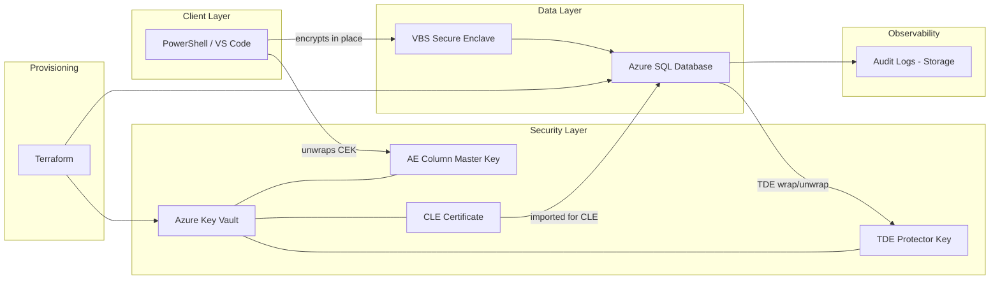
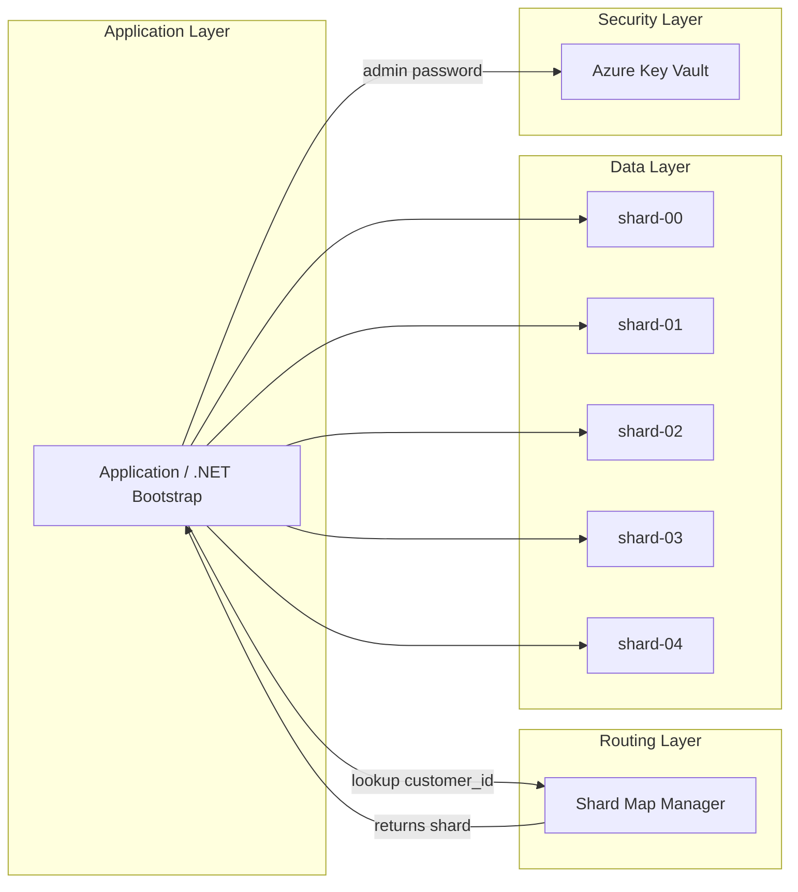

# Hello, I'm Emmanuel

I build and maintain the systems that keep data running — secure, available, and efficient. By combining cloud, infrastructure, and automation, I make sure everything works reliably behind the scenes.

---

## 🚀 Featured Database Engineering Projects

### 1. Encrypting Azure SQL Database: TDE, Cell-Level Encryption and Always Encrypted

`Terraform` · `Azure SQL Database` · `Azure Key Vault` · `T-SQL` · `PowerShell` · `Bash` · `sqlcmd`

Built a single Terraform-provisioned Azure SQL environment that layers all three of SQL's encryption features, and proved for each one **where the data is encrypted, and who can still read it**.

This project addresses a question encryption alone doesn't answer: who holds the key. TDE protects the files at rest but is transparent to anyone who can query the database. Cell-level encryption protects chosen columns but still leaves the keys inside the database, where an administrator can reach them. Always Encrypted moves the key to the client, so even a database administrator sees only ciphertext.

#### What I Focused On

- Enabling TDE with a customer-managed RSA key in Key Vault, with purge protection, wrap/unwrap-only key operations and a least-privilege access policy for the server's managed identity
- Implementing cell-level encryption with a certificate generated in Key Vault and imported into SQL, then proving a non-admin user needs two separate grants, one on the key and one on the certificate, before decryption works
- Deploying Always Encrypted with a VBS secure enclave and an enclave-enabled column master key in Key Vault, so existing data is encrypted in place without leaving the server
- Encrypting four bank columns with PowerShell `Set-SqlColumnEncryption`, choosing deterministic or randomized per column based on lookup needs and leakage risk
- Classifying sensitive columns before encryption and confirming the labels survive it
- Auditing the server to a storage account with Microsoft's recommended action groups, and logging Key Vault access
- Running the database work from VS Code and `sqlcmd` with Entra ID access tokens, and recording evidence for every step

#### Repository

→ [View Azure SQL Encryption Project](https://github.com/hardeymolhar/Implementing-TDE-Cell-Level-Encryption-and-Always-Encrypted)

#### 🏗 System Architecture

---

### 2. Horizontally Sharded Multi-Write-Primary Azure SQL Platform

`Terraform` · `Azure SQL Database` · `Elastic Database Client Library` · `.NET` · `Azure Key Vault` · `T-SQL`

Built a horizontally sharded Azure SQL platform that distributes business customers across five independent databases, each carrying its own write primary and transaction log.

This project addresses the point where vertical scaling stops working. A single Azure SQL database has one primary replica, so every write in the system funnels through it. Sharding adds write capacity by adding databases rather than buying a larger one, while a routing catalog keeps the application unaware of where any given customer lives.

#### What I Focused On

- Distributing write load across five shard databases so no single primary becomes the bottleneck
- Using a List shard map keyed on `customer_id`, chosen over a Range map so a single hot customer can be relocated without moving a cohort
- Building a .NET bootstrap on the Elastic Database Client Library that registers the shards and validates its own writes by reading them back
- Applying identical idempotent DDL to every shard from one script, keeping the shards interchangeable for the routing layer
- Leading every table and index with the shard key, so customer-scoped queries stay inside a single shard
- Provisioning the full estate with Terraform for consistent, repeatable deployment
- Resolving the SQL administrator password from Azure Key Vault at runtime, keeping secrets out of the repository

#### Repository

→ [View Azure SQL Sharding Project](https://github.com/hardeymolhar/azure-sql-sharding-automation/tree/range-shard-map)
#### 🏗 System Architecture

---

## 🧰 Tech Stack

**Databases & DBA Tools**

**Cloud, Automation & Tooling**

---

## 📫 Connect

