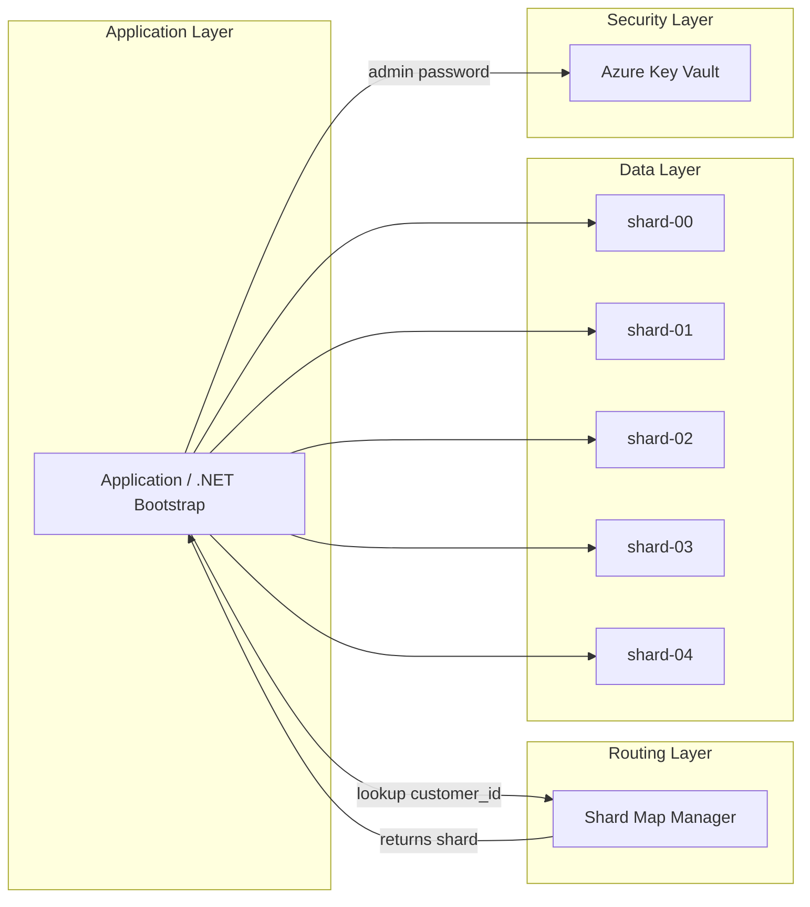
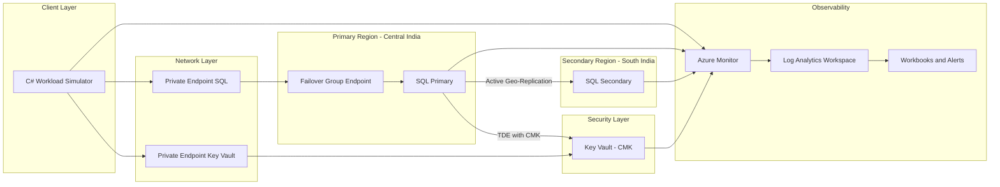
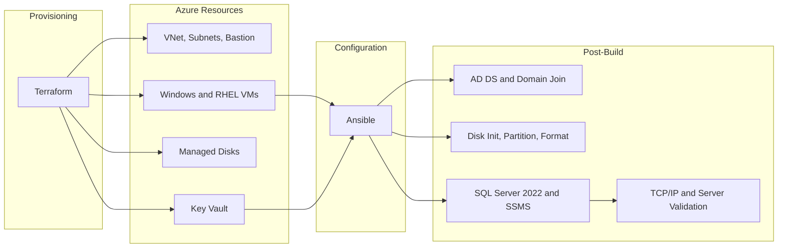
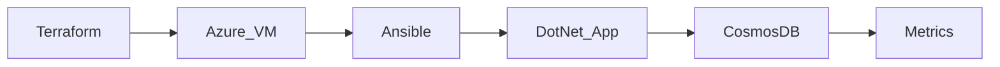

# Hello, I'm Emmanuel

**On-Premises & Cloud Database Administrator** with proven experience supporting mission-critical **SQL Server** and **Oracle** systems in a top-tier Nigerian bank, across on-premises and Azure environments.

I build and maintain the systems that keep data running — secure, available, and efficient. By combining cloud, infrastructure, and automation, I make sure everything works reliably behind the scenes.

---

## 🚀 Featured Database Engineering Projects

### 1. Horizontally Sharded Multi-Write-Primary Azure SQL Platform

`Terraform` · `Azure SQL Database` · `Elastic Database Client Library` · `.NET` · `Azure Key Vault` · `T-SQL`

Built a horizontally sharded Azure SQL platform that distributes business customers across five independent databases, each carrying its own write primary and transaction log.

This project addresses the point where vertical scaling stops working. A single Azure SQL database has one primary replica, so every write in the system funnels through it. Sharding adds write capacity by adding databases rather than buying a larger one, while a routing catalog keeps the application unaware of where any given customer lives.

#### What I Focused On

- Distributing write load across five shard databases so no single primary becomes the bottleneck
- Using a List shard map keyed on `customer_id`, chosen over a Range map so a single hot customer can be relocated without moving a cohort
- Building a .NET bootstrap on the Elastic Database Client Library that registers the shards and validates its own writes by reading them back
- Applying identical idempotent DDL to every shard from one script, keeping the shards interchangeable for the routing layer
- Leading every table and index with the shard key, so customer-scoped queries stay inside a single shard
- Provisioning the full estate with Terraform for consistent, repeatable deployment
- Resolving the SQL administrator password from Azure Key Vault at runtime, keeping secrets out of the repository

#### Repository

→ [View Azure SQL Sharding Project](https://github.com/hardeymolhar/azure-sql-sharding-automation/tree/range-shard-map)
#### 🏗 System Architecture

---

### 2. Azure SQL Automated Infrastructure

> 2026 – Present · two sub-projects in one repository

An Infrastructure-as-Code platform for enterprise Azure SQL environments, covering both halves of the problem: **provisioning and configuring the infrastructure**, and **making the data tier survive a regional failure**.

**Repository** → [azure-sql-automated-infrastructure](https://github.com/hardeymolhar/azure-sql-automated-infrastructure/tree/feature/resource-variable-injection)

#### 2.1 Azure SQL High Availability & Disaster Recovery

`Terraform` · `Azure SQL Database` · `Failover Groups` · `Active Geo-Replication` · `Private Endpoints` · `TDE with CMK` · `C#`

Deployed and failover-tested a multi-region Azure SQL estate to evaluate HA/DR architectures against realistic workload conditions.

**What I Focused On**

- Deploying a multi-region estate spanning Central India and South India: 2 logical servers, 20 primary databases, and 10 geo-replicated secondaries
- Implementing Failover Groups alongside Active Geo-Replication to compare failover behaviour and operational trade-offs between the two
- Securing connectivity with Private Endpoints, Private DNS Zones, and customer-managed Transparent Data Encryption keys
- Building a C# workload simulator generating concurrent sessions and batch transactions, to validate geo-replication and failover readiness under load
- Monitoring CPU, I/O, latency, connections, and query performance through Query Performance Insight and Azure Monitor during failover testing

##### 🏗 System Architecture

#### 2.2 Azure SQL Automated Platform

`Terraform` · `Ansible` · `Bash` · `Azure` · `SQL Server 2022` · `Windows` · `RHEL`

Automated the full build of SQL Server environments on Azure, from empty subscription to a validated, domain-joined instance — with no manual installation steps.

**What I Focused On**

- Architecting and automating Azure provisioning with Terraform: virtual machines, networking, Bastion, managed disks, and Key Vault integration
- Automating Active Directory Domain Services deployment and domain-join workflows for SQL Server infrastructure
- Automating managed disk initialisation, partitioning, and formatting across both Windows and Linux virtual machines using Ansible
- Developing unattended SQL Server and SSMS installation playbooks with standardised post-installation configuration, including TCP/IP enablement and server validation

##### 🏗 System Architecture

---

### 3. Cosmos DB Batch Ingestion Demo

`Terraform` · `Ansible` · `Azure Cosmos DB` · `.NET` · `Azure Monitor`

Built a test environment to understand how Azure Cosmos DB handles high-volume data ingestion, and how to tune it for performance and cost.

This project simulates real-world scenarios where large volumes of data must be written efficiently, making it possible to observe how throughput (RU/s) and system behaviour change under sustained load.

#### What I Focused On

- Monitoring request unit (RU) consumption during heavy data ingestion
- Testing batch ingestion patterns to improve throughput and reduce cost
- Provisioning infrastructure with Terraform for consistent, repeatable deployment
- Using Ansible to configure virtual machines and standardise the environment

#### Repository

→ [View Cosmos DB Project](https://github.com/hardeymolhar/azure-data-platform)

#### 🏗 System Architecture

---

## 🧰 Tech Stack

**Databases & DBA Tools**

**Cloud, Automation & Tooling**

---

## 📫 Connect

